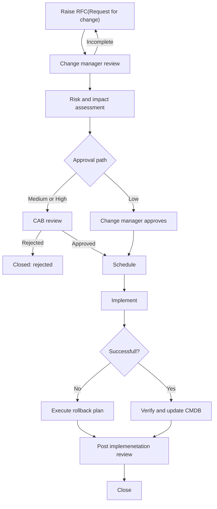

# Change Management Policy
**Organisation:** North Technology Services (fictional)\
**Owner:** Change Manager\
**Version:** 1.0\
**Review:** Quarterly
## 1. Purpose
This policy sets out how North Technology Services plans, assesses, approves, and implements changes to IT services, so that changes deliver their intended benefit with minimal disruption.
## 2. Scope
The policy applies to any addition, modification, or removal of anything that could affect an IT service. This includes hardware, software, network and cloud configuration, security settings, and service documentation held in the CMDB.
Out of scope: routine service requests (see the service catalogue) and changes to business processes that do not affect IT services.
## 3. Change types
| Type | Definition | Approval | Example | 
|------|------------|----------|---------|
| Standard | Low risk, repeatable, with a documented and tested procedure | Pre-approved | Adding a user to a security group, monthly workstation patching |
| Normal | Any change that is not standard or emergency | Change manager or CAB (change advisory board), based on risk | firewall rule change, cloud migration |
| Emergency | Must be implemented urgently to restore service/s or close a serious security risk | Emergency CAB (ECAB) | Applying a zero day security patch, major outage resolution |

A normal change can become a standard change after it has been successfully implemented at least three times and the change manager has approved its procedure. 
## 4. Risk assessment
Every normal and emergency change is rated using the risk matrix below. The rating sets the approval path.
| Likelihood of disruption / Impact | Single user or team | One service | Multiple services | Organisational wide |
|---|---|---|---|---|
| **Likely** | Medium | High | High | High |
| **Possible** | Low | Medium | High | High |
| **Unlikely** | Low | Low | Medium | High |

|Risk | Approver | Lead time |
|---|---|---|
| Low | Change manager | 2 Business days |
| Medium | CAB | 5 Business days |
| High | CAB, with business owner sign off | 10 business days |

```math
\text{Average change lead time} = \frac{\sum (\text{Deployment start time} - \text{Submission time})}{\text{Total number of changes completed}}
```
Use the CMDB to identify every service and configuration item affected before rating impact.
## 5. Change lifecycle

## 6. RFC required information
- Description and business justification
- Affected services and configuration items from the CMDB
- Risk assessment
- Implementation plan with timings listed in 24hr AEST
- Test plan and evidence of testing
- Rollback plan
- Communication plan for affected users
- Implementer and technical approver
## 7. Change windows and freezes
- **Standard change window:** Tuesday and Thursday, 1800 - 2200.
- **Change freeze:** 10 December to 5 January. Only emergency changes are permitted.
## 8. Emergency change
1. The implementer contacts the 24hr Incident Manager.
2. The ECAB (Change Manager and Incident Manager) approves the change, and the approval is recorded in the ticket.
3. The change is implemented and documented in full within 1 business day.
4. Every emergency change is reviewed at the next CAB.
## 9. Post implementation Review (PIR)
A PIR is required for every failed change, emergency change, and every change that caused an incident. This is to record what happened, why, and what actions to prevent this from happening again. Theses findings go to problem management where the root caused is investigated. 

Incident, change, and problem management feed into each other, but not in a fixed circle. An incident can trigger a problem record to investigate a root cause, and the fix will usually come from a change. A failed change can cause a new incident, and the cycle repeats. 

However, they don't always connect, a problem can be raised proactively through trend analysis before an incident occurs, and most changes are through routine upgrades and planned improvement that don't revolve around an incident occuring.
## 10. Measures
| Measure | Target |
| --- | --- |
| Changes implemented successfully first time | 90% or more |
| Changes causing a P1 or P2 incident | Less than 5% |
| Emergency changes as a share of all changes | Less than 10% |
| RFCs submitted within lead time | 90% or more |
## 11. Roles and responsibilities
| Role | Responsibilities |
| --- | --- |
| Change Manager | Owns the policy, reviews RFCs, chairs CAB, and reports measures |
| CAB members | Assess risk and readiness for each of their areas |
| Change owner | Raises the RFC and is accountable for the change |
| Implementer | Carries out and verifies the changes, as well as updating the CMDB |
| Service Owner | Approves changes to their service/s and accepts the business risk |
| Incident Manager | Raises emergency changes to restore service and flags incidents caused by changes |
