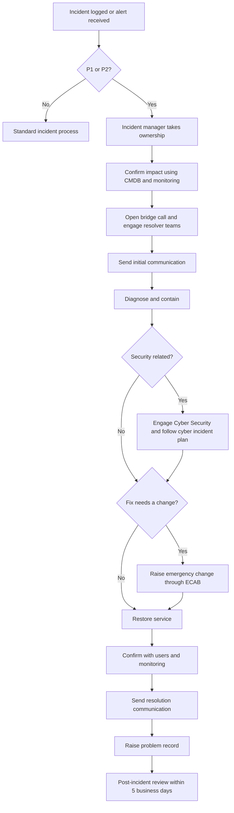

# High priority incident runbook (P1 and P2)
**Organisation:** North Technology Services *(fictional)*
**Owner:** High Priority Incident Manager
A high priority incident is any P1 or P2 incident, or any incident the incident manager declares high priority because of its business or reputational impact.
## Process overview

## Step by step
### 1. Take ownership (first 15 minutes)
- [ ] Accept the ticket and set yourself as Incident manager.
- [ ] Confirm the priority using the [priority matrix](03-incident-priority-and-risk-matrix.md).
- [ ] Check the CMDB for affected configuration items, dependent services and the resolver group.
- [ ] Check for recent changes on affected items in the change schedule.
- [ ] Check for related open incidents and known errors.
### 2. Mobilise
- [ ] Open the bridge call and post the link in the ticket.
- [ ] Call out the resolver teams and vendors identified from the CMDB.
- [ ] Notify the service owner and duty manager.
### 3. Communicate
- [ ] Send the initial notification within 30 minutes of declaring the major incident.
- [ ] Update stakeholders on schedule: every hour for P1, every 2 hours for P2.
- [ ] Notify the service desk so they can tag new calls to this incident.
### 4. Diagnose, contain and restore
- [ ] Agree a working theory and next action at each bridge checkpoint.
- [ ] Assess risk at every checkpoint: is the impact spreading, is data at risk, is it security related?
- [ ] Decide on drastic actions, such as shutting down a system, with the service owner. Record the decision and reason.
- [ ] If the fix needs a change, raise an emergency change through ECAB.
### 5. Resolve and close
- [ ] Confirm restoration with monitoring and at least two affected users.
- [ ] Send the resolution notification.
- [ ] Raise a problem record for root cause analysis.
- [ ] Schedule the post-incident review.
## Communication templates
**Initial notification**
> **Subject:** [P1] Incident XX/XX/20XX: <service> unavailable
>
> The Incident management team have found that <service> is unavailable for <who is affected> since <time>. Technical teams are working to restore it. Workaround: <workaround or "none available">. Next update: <time>.
**Update**
> **Subject:** [P1] Update <n> XX/XX/20XX: <service>
>
> Current status: <what we know>. Actions under way: <what teams are doing>. Expected restoration: <time or "not yet known">. Next update: <time>.
**Resolution**
> **Subject:** [Resolved] <service> restored
>
> <Service> was restored at <time>. Cause: <brief cause, or "under investigation">. If you are still having problems, contact the service desk on <number> and quote <incident ID>.
## Post-incident review agenda
1. Timeline of events
2. What worked well
3. What could have gone better (detection, response, communication)
4. Root cause, or problem record reference if still under investigation
5. Actions, with owners and due dates
## Roles on the bridge
| Role | Responsibility |
| --- | --- |
| High priority Incident Manager | Owns the incident, runs the bridge, makes or escalates decisions |
| Resolver teams and vendors | Diagnose and fix |
| Service owner | Accepts business risk and approves drastic actions |
