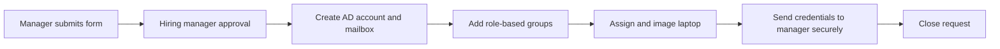
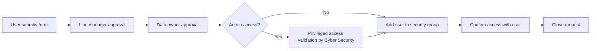
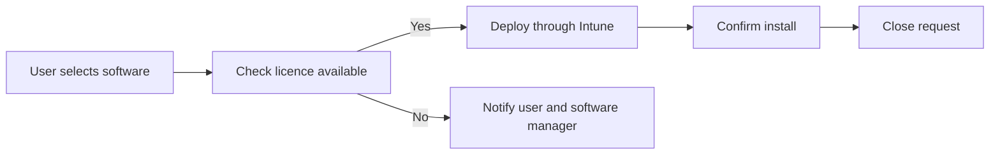
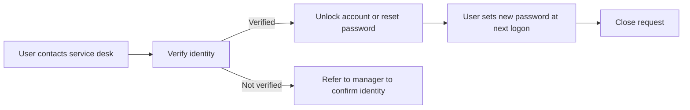

# Service catalogue: sample items
**Organisation:** North Technology Services *(fictional)*
Service requests are standard, pre-approved requests from users where nothing is broken. Each catalogue item defines what the user can ask for, the information collected, who approves it, and how it is fulfilled.
| Item | Category | Approval | Fulfilment target |
| --- | --- | --- | --- |
| [SR-01 New starter account](#sr-01-new-starter-account) | Accounts | Hiring manager | 3 business days before start date |
| [SR-02 Access to a system or shared folder](#sr-02-access-to-a-system-or-shared-folder) | Access | Line manager and data owner | 2 business days |
| [SR-03 Standard software install](#sr-03-standard-software-install) | Software | None (approved list) | 1 business day |
| [SR-04 Account unlock or password reset](#sr-04-account-unlock-or-password-reset) | Accounts | None (identity verified) | 1 hour |
---
## SR-01 New starter account
**Description:** creates an Active Directory account, Microsoft 365 mailbox, group memberships and a laptop for a new staff member or contractor.
**Form fields**
| Field | Type | Required |
| --- | --- | --- |
| Full name | Text | Yes |
| Start date | Date | Yes |
| Position and team | Text | Yes |
| Employment type | Staff / Contractor | Yes |
| Contract end date | Date | If contractor |
| Copy access from (existing user in the same role) | User lookup | No |
| Security clearance held | List | Yes |
| Hardware needed | Standard laptop / Laptop and dock | Yes |

**Notes:** contractor accounts expire automatically on the contract end date. Group membership is based on role, not copied from another user, unless the manager confirms the role is identical.

---
## SR-02 Access to a system or shared folder
**Description:** grants a user access to an application or shared folder by adding them to the relevant security group.
**Form fields**
| Field | Type | Required |
| --- | --- | --- |
| User needing access | User lookup | Yes |
| System or folder | List (from CMDB) | Yes |
| Access level | Read / Edit / Admin | Yes |
| Business reason | Text | Yes |
| End date (if temporary) | Date | No |

**Notes:** the data owner is pulled from the CMDB record for the system. Admin access requests are validated when first requested, in line with the Essential Eight.

---
## SR-03 Standard software install
**Description:** installs software from the approved software list. Software not on the list must go through a software assessment request instead.
**Form fields**
| Field | Type | Required |
| --- | --- | --- |
| Software | List (approved software only) | Yes |
| Device | Device lookup | Yes |

**Notes:** this item is fulfilled automatically where a licence is available, with no manual step.

---
## SR-04 Account unlock or password reset
**Description:** unlocks a locked account or resets a forgotten password after verifying the user's identity.

**Notes:** users are encouraged to use self-service password reset. Repeated lockouts on one account in a short period are referred to Cyber Security as a possible security incident.

---
## Measures
| Measure | Target |
| --- | --- |
| Requests fulfilled within target | 90% or more |
| New starter accounts ready on start date | 85% or more |
| Requests fulfilled with no manual step (SR-03, self-service SR-04) | Increase quarter on quarter |
| User satisfaction with request fulfilment | 4 out of 5 or higher |
