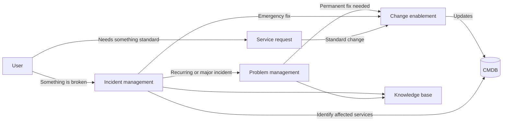

# ITIL 4 Process Pack
A set of ITIL 4 aligned service management documents for a fictional organisation, **North Technology Services**, an IT provider supporting about 10,000 staff.
The pack covers change enablement, incident management, and service request management: the policies, templates, and runbooks a service desk and change team use day to day.
> **Disclaimer:** This is a personal portfolio project. North Technology Services, it's systems and it's people are fictional. The documents are written from general ITIL 4 practice and are not copied from any employer.
## What's in this repo
| Document | Purpose |
| --- | --- |
| [01-change-management-policy.md](01-change-management-policy.md) | Change types, risk assessment, approval authority, and change lifecycle |
| [02-cab-meeting-template.md](02-cab-meeting-template.md) | Agenda and meeting minutes template for the Change Advisory Board |
| [03-incident-priority-and-risk-matrix.md](03-incident-priority-and-risk-matrix.md) | Impact and urgency matrix, priority definitions, response, and resolution targets |
| [04-major-incident-runbook.md](04-major-incident-runbook.md) | Step-by-step process for P1 and P2 incidents, with communication templates |
| [05-service-catalogue.md](05-service-catalogue.md) | Four sample catalogue items with forms, approvals, and fulfilment workflows |
## How the processes connect

## ITIL 4 practices covered
- Change enablement
- Incident management
- Service request management
- Problem management (interfaces only)
- Service configuration management (CMDB use)
- Knowledge management (interfaces only)
## Planned additions
- Problem management procedure and known error template
- Knowledge article template
## About
Created by Sienna Winter (ITIL 4 Foundation) as a portfolio project in IT service management.
